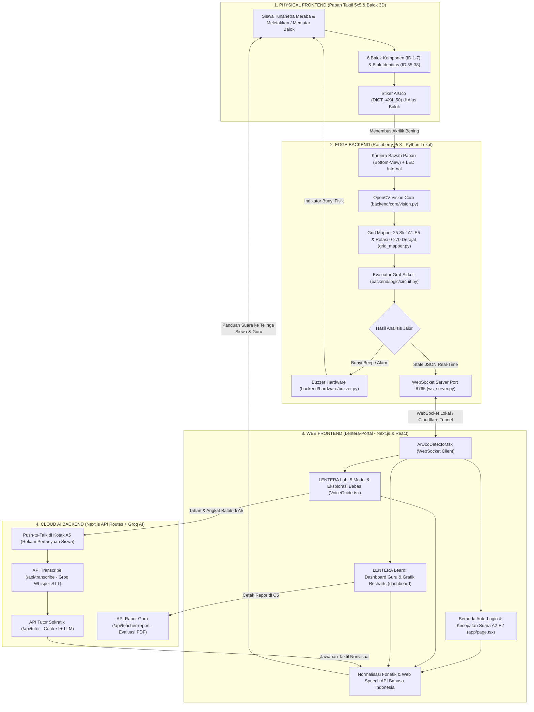

# MASTER PEDOMAN PRESENTASI & TANYA-JAWAB (Q&A) DEWAN JURI LIDM — LENTERA
*(1 File Gabungan Utuh — Diselaraskan 100% dengan **LENTERA_Laporan_Akhir_Final (1).docx**, Pedoman Dosen/Pak Rasyid/Pak Aris, & Rubrik Final LIDM)*

Dokumen ini disusun menjadi **3 Bagian Utama** agar sangat mudah dibaca saat persiapan maupun di atas panggung:
1. **[BAGIAN 1: NOTULEN ARAHAN TAKTIS PANGGUNG, BUKTI VISUAL & ETIKA TANYA JAWAB](#bagian-1-notulen-arahan-taktis-panggung-bukti-visual--etika-tanya-jawab)** *(Wajib Diterapkan Semua Anggota)*
2. **[BAGIAN 2 — VERSI 1: BAHASA MUDAH DIPAHAMI & TIDAK TERLALU TEKNIS](#bagian-2--versi-1-bahasa-mudah-dipahami--tidak-terlalu-teknis-siap-ucap-ke-juri)** *(Bahasa sehari-hari yang mengalir, ringkas, bebas istilah rumit, dan langsung mudah ditangkap semua juri)*
3. **[BAGIAN 3 — VERSI 2: BAHASA ASLI / LENGKAP & TEKNIS](#bagian-3--versi-2-bahasa-asli--lengkap--teknis-sesuai-jawaban-detail--laporan-akhir)** *(Tetap seperti jawaban detail sebelumnya lengkap dengan tabel, istilah engineering, dan rincian angka Laporan Akhir Final)*

---

# BAGIAN 1: NOTULEN ARAHAN TAKTIS PANGGUNG, BUKTI VISUAL & ETIKA TANYA JAWAB

### 1. Persiapan Layar Sebelum Maju (Semua Tab Wajib Sudah Dibuka!)
Pastikan seluruh tab di laptop operator **sudah terbuka dan siap ditampilkan dalam 1 klik** sebelum tim dipanggil:
- **Tab Foto & Video Dokumentasi:** Bukti pengujian nyata bersama siswa dan guru tunanetra di lapangan.
- **Tab Gamtek (Gambar Teknik & Desain 3D SolidWorks):** Wajib langsung dibuka saat juri bertanya tentang **Orisinalitas, Inovasi, atau Proses Pembuatan Alat** untuk membuktikan alat dirancang sendiri oleh tim.
- **Tab Kurikulum & Modul Ajar (PDF):** Wajib langsung dibuka saat menjelaskan **Manfaat bagi Tunanetra**, membuktikan siswa mampu belajar rangkaian listrik sesuai kurikulum **tanpa takut tersengat listrik**.
- **Tab Website LENTERA (`LENTERA Lab`, `LENTERA Learn`, & `Panduan`):** Siap untuk demonstrasi langsung.

### 2. Strategi Demonstrasi & "Ngumpan" ke Luthfi
- **Pangkas Fitur yang Dibahas (*Cut to the Point*):** Jangan mendemokan semua fitur hingga bertele-tele. Tampilkan fitur inti yang paling kuat saja.
- **Tunjukkan Skenario Saat Siswa Salah Pasang:** Sengaja peragakan saat balok dipasang **salah arah / jalur belum tertutup**, agar juri mendengar langsung bagaimana LENTERA mendeteksi kesalahan tersebut dan memberikan koreksi suara secara cerdas.
- **Ngumpan ke Luthfi (*Testimoni Langsung*):** Berikan umpan kepada **Luthfi** untuk menyampaikan testimoni singkat dari sudut pandang pengguna tunanetra sebagai **penekanan validasi nyata**.

### 3. Sikap Tubuh, Penampilan Non-Teknis & Vokal
- **Penampilan Non-Teknis:** **Kantong celana/rok wajib kosong** (tidak boleh menggelembung karena HP/dompet/kunci), **kantong jas almamater (almet) kosong**, rapi/dandan segar, postur tegap.
- **Cara Menjawab:** **Jangan bicara terlalu cepat!** Gunakan kalimat **ringkas dan jelas**, perhatikan **intonasi dan artikulasi**, serta tampilkan semangat penuh (*"di-pol-ke rek!"*).

### 4. Aturan "Maksimal 2 Sangkalan" & Kalimat Penutup Puncak
- **Maksimal 2 Sangkalan:** Jika juri mengkritisi/mendebat, jawab dengan sopan maksimal **2 kali sangkalan** berdata. Jika masih ditekan untuk ketiga kalinya, langsung tutup dengan elegan:
  > *"Baik Bapak/Ibu Dewan Juri, terima kasih banyak atas saran dan masukannya. Hal tersebut menjadi catatan evaluasi yang sangat berharga bagi tim kami untuk menyempurnakan LENTERA ke depannya."*
- **Kalimat Penutup Puncak (Diucapkan Setelah Sesi Tanya Jawab Berakhir):**
  > *"Sebagai penutup Bapak/Ibu Dewan Juri, izinkan kami menyampaikan pesan dari guru kami di SLB: **Teman-teman berkebutuhan khusus bukanlah puntung rokok di tong sampah, melainkan batang emas yang tertimbun lumpur.** Mereka tidak untuk dikasihani, tetapi **diberi kesempatan yang sama untuk mengakses pendidikan dan literasi teknologi.** Terima kasih."*

---
---

# BAGIAN 2 — VERSI 1: BAHASA MUDAH DIPAHAMI & TIDAK TERLALU TEKNIS (SIAP UCAP KE JURI)
*(Gunakan versi ini saat berbicara langsung di depan juri agar terdengar luwes, jelas, tidak kaku, dan mudah dipahami oleh juri dari latar belakang pendidikan maupun teknologi)*

---

## A. Tiga Pertanyaan Inti Penajaman Produk (Versi Bahasa Mudah)

### 1. Apa yang bisa dilakukan pengguna dengan LENTERA yang sebelumnya sulit mereka lakukan?
*(Sambil buka Tab Kurikulum & Foto Pengujian)*
> *"Bapak/Ibu, selama ini teman-teman tunanetra—baik yang buta total maupun yang masih punya sedikit sisa penglihatan jarak dekat—sangat kesulitan saat belajar rangkaian listrik. Kenapa? Karena pelajaran listrik biasanya mengandalkan gambar di buku, warna kabel, dan melihat nyala lampu. Selain itu, mereka takut tersetrum kalau langsung memegang kabel beraliran listrik.*
>
> *Karena teman-teman tunanetra tidak melihat, kami membuat inovasi yang **bisa diraba dan didengar**, yaitu mengoptimalkan **indera peraba dan pendengaran** mereka:*
> - **Bagi Siswa Tunanetra:** *Sekarang mereka bisa meraba langsung bentuk 6 komponen listrik di atas papan 5×5, menyusun sendiri rangkaian seri dan paralel **tanpa takut tersengat listrik**, dan alat akan langsung memberi tahu lewat suara apakah rangkaian mereka sudah benar atau masih ada yang terputus. Mereka juga bisa mengatur sendiri kecepatan suara alat dan bertanya ke asisten suara (AI Tutor) secara mandiri tanpa perlu mengklik layar komputer.*
> - **Bagi Guru:** *Guru tidak perlu lagi mengecek sambungan kabel siswa satu per satu secara manual, karena hasil praktikum siswa langsung tercatat rapi dan objektif di website LENTERA."*

### 2. Bagian teknis mana yang benar-benar dibangun tim dan bagaimana cara kerjanya?
*(Sambil buka Tab Gamtek Desain SolidWorks)*
> *"Tim kami membangun sendiri **tiga bagian utama yang saling terhubung, yaitu Alat Fisik, Sistem Kamera & Suara Pintar, serta Website**:*
> 1. **Alat Fisik (Desain SolidWorks & Cetak 3D):** *Kami menggambar sendiri desain papan berkotak 5×5 dan balok-balok komponennya menggunakan aplikasi **SolidWorks**, lalu mencetaknya dengan **mesin 3D Printer**. Di bagian atas balok ada bentuk timbul dan huruf Braille untuk diraba siswa, sedangkan di bagian bawah balok kami tempel kode penanda khusus (seperti barcode bernama ArUco).*
> 2. **Kamera Bawah Papan & Otak Alat (Raspberry Pi 3):** *Di bagian dalam bawah kotak, kami memasang kamera yang menghadap ke atas menembus kaca akrilik bening dan diterangi lampu LED di dalamnya. Kenapa kameranya di bawah? Supaya saat tangan siswa meraba di atas papan, **tangan mereka tidak menghalangi kamera**. Begitu balok diletakkan atau diputar, kamera langsung mengenali itu balok apa, ditaruh di kotak nomor berapa, dan menghadap ke mana. Otak alat (Raspberry Pi 3) kemudian mengecek apakah susunan baloknya sudah membentuk jalur listrik yang utuh atau belum, lalu mengeluarkan suara panduan serta melayani tanya-jawab suara dengan siswa.*
> 3. **Website LENTERA:** *Kami juga membuat website yang terhubung langsung dengan papan, sehingga guru bisa melihat perkembangan belajar tiap siswa dan mengunduh rapor hasil praktikumnya."*

### 3. Data apa yang mendukung klaim manfaat itu?
> *"Manfaat dan kemudahan penggunaan LENTERA didukung oleh **data uji coba nyata bersama 10 pengguna (yaitu 5 siswa dan 5 guru di SLB)** serta **wawancara mendalam dengan guru pendamping**:*
> 1. **Penilaian Guru di Lapangan (Nilai 9 dari 10):** *Dalam wawancara mendalam, guru menilai alat ini sangat membantu siswa mengenal komponen serta memahami bedanya rangkaian seri dan paralel secara aman tanpa takut tersetrum, dan memberikan nilai fungsionalitas **9 dari 10**.*
> 2. **Bukti Perbaikan Nyata dari Masukan Pengguna:** *Saat uji coba awal, guru memberi masukan bahwa huruf Braille terlalu rapat dengan huruf timbul dan suara panduannya kurang cepat bagi siswa yang sudah terbiasa. Masukan itu langsung kami wujudkan di alat versi kedua ini: **posisi Braille sudah kami pisahkan agar nyaman diraba, kami tambahkan 5 pilihan kecepatan suara, dan kami buatkan Buku Panduan serta Modul Ajar lengkap**.*
> 3. **Kenaikan Skor Kemudahan Penggunaan (SUS):** *Dari pengisian kuesioner kemudahan penggunaan (SUS) oleh **10 pengguna (5 siswa dan 5 guru)** dalam dua tahap pengujian, skor rata-ratanya naik dari **78,50** pada tahap pertama menjadi **91,50** pada tahap kedua (naik **13 poin**). Skor siswa naik dari **76 menjadi 90**, dan skor guru naik dari **81 menjadi 93**."*

---

## B. Hasil Diskusi Siang Tadi: Arsitektur, SLB Negeri Semarang & Grid 5×5 (Versi Bahasa Mudah)

### 4. Kalo ditanya: "Arsitektur apa yang kalian gunakan? Bagian mana Frontend dan bagian mana Backend-nya?"
- **Jawaban Mudah & Singkat tentang Arsitektur:**
  > *"Singkatnya Bapak/Ibu, kami menggunakan **Arsitektur Papan Raba Pintar berbasis Lokal dan Cloud (Tangible User Interface Edge-Cloud Hybrid)**. Artinya, proses membaca balok dengan kamera bawah dan mengecek sambungan rangkaian dilakukan **langsung di dalam alat (lokal/Edge)** supaya responnya cepat, lalu hasilnya dikirim secara langsung ke **Website guru dan fitur tanya-jawab AI Tutor (Cloud)**."*
- **Jawaban Mudah tentang Pembagian Frontend vs Backend:**
  > *"Kalau dibagi menjadi **Frontend** dan **Backend**, di sistem LENTERA pembagiannya sangat jelas:*
  > 1. **Bagian FRONTEND (Yang Dilihat, Diraba, & Didengar Pengguna) — Ada 2 sisi:**
  >    - **Frontend Fisik (Untuk Siswa Tunanetra):** *Yaitu **Papan Taktil 5×5, balok-balok komponen 3D ber-Braille, serta suara panduan**. Jadi bagi siswa tunanetra, papan fisik inilah 'layar' yang mereka raba dan dengar.*
  >    - **Frontend Web (`Lentera-Portal` berbasis Next.js — Untuk Guru & Tampilan Layar):** *Yaitu tampilan website yang membuka halaman Beranda, ruang praktikum **LENTERA Lab**, dashboard nilai guru **LENTERA Learn**, serta pemutar suara narator di browser.*
  > 2. **Bagian BACKEND (Otak Pemroses di Balik Layar) — Juga ada 2 lapis:**
  >    - **Backend Lokal di Dalam Alat (Python di Raspberry Pi 3 — folder `backend/` & `main.py`):** *Tugasnya menyalakan kamera bawah, membaca kode ArUco di bawah balok dengan **OpenCV**, menghitung apakah jalur listriknya sudah nyambung atau korsleting, membunyikan buzzer, lalu mengirim datanya secara real-time lewat **WebSocket** ke website.*
  >    - **Backend AI di Website (`app/api/`):** *Tugasnya memproses rekaman suara saat siswa bertanya di kotak `A5` dan menghasilkan jawaban bimbingan dari **AI Tutor** serta menyusun **Rapor AI PDF** untuk guru."*
- **Jawaban Mudah & Singkat tentang Tech Stack (Teknologi yang Dipakai):**
  > *"Untuk **Tech Stack**-nya, kami membaginya menjadi 4 bagian utama:*
  > 1. **Desain & Alat Fisik:** ***SolidWorks*** *(untuk desain 3D), **3D Printing PLA**, dan **Raspberry Pi 3** sebagai komputer di dalam alat.*
  > 2. **Backend Alat & Kamera:** ***Python***, ***OpenCV*** *(untuk membaca kode ArUco dari kamera bawah)*, ***Model Graf (NetworkX)*** *(untuk mengecek sambungan listrik)*, dan ***WebSocket*** *(untuk mengirim data real-time).*
  > 3. **Frontend & Website:** ***Next.js (React & TypeScript)***, ***Tailwind CSS***, ***Recharts*** *(untuk grafik nilai guru)*, serta ***Web Speech API*** *(untuk suara narator Bahasa Indonesia).*
  > 4. **Kecerdasan Buatan (AI Tutor):** ***Groq Whisper*** *(untuk mengubah suara pertanyaan siswa jadi teks)* dan ***Large Language Model (LLM)*** *berpendekatan Sokratik untuk menjawab pertanyaan siswa."*

### 5. Kalo ditanya: "Kan kamu hanya mengetes di SLB Negeri Semarang, emangnya sudah nyoba di daerah lain?"
- **Jawaban Mudah & Mengena:**
  > *"Betul Bapak/Ibu, pada tahap ini pengujian kami lakukan di **SLB Negeri Semarang**. Alasannya, SLB Negeri Semarang adalah **salah satu SLB rujukan terbesar di Jawa Tengah**. Logikanya, jika di sekolah rujukan terbesar di ibu kota provinsi saja belum ada alat praktikum rangkaian listrik yang aman dan bisa diakses mandiri oleh siswa tunanetra, maka SLB di daerah lain tentu menghadapi kendala yang sama atau bahkan lebih besar.*
  > *Supaya alat ini siap dibawa ke daerah lain, kami sudah menyiapkan **3 hal**: (1) materinya mengikuti **Kurikulum Merdeka nasional** lengkap dengan Buku Panduan & Modul Ajar, (2) baloknya dicetak 3D **tanpa mesin/kabel rumit di dalam balok** sehingga murah dan mudah diganti jika rusak, dan (3) **praktikum utamanya berjalan lewat hotspot lokal alat** tanpa perlu internet cepat."*

### 6. Kalo ditanya: "Mengapa ukuran grid papannya 5×5 (25 kotak)? Kenapa tidak lebih kecil atau lebih besar?"
- **Jawaban Mudah (3 Alasan Sederhana):**
  > *"Kami memilih ukuran **5×5 (25 kotak)** karena **3 alasan praktis bagi siswa tunanetra**:*
  > 1. **Pas dengan jangkauan dua tangan:** *Dengan ukuran tiap kotak 4 × 4 cm, lebar total papan sekitar 31 × 31 cm. Ukuran ini pas diraba oleh kedua tangan siswa dari ujung ke ujung tanpa harus menggeser duduknya. Kalau 8×8 terlalu lebar dan bikin bingung, kalau 3×3 terlalu sempit.*
  > 2. **Punya satu kotak tepat di tengah (C3):** *Karena jumlahnya ganjil (5×5), ada satu kotak yang posisinya persis di tengah-tengah papan yaitu **C3**. Kotak tengah ini sangat membantu siswa tunanetra sebagai patokan tangan saat meraba.*
  > 3. **Cukup untuk merakit rangkaian paralel 2 cabang sekaligus tombol menu:** *Ukuran 5×5 pas untuk menyusun rangkaian bercabang (paralel) dua lampu di tengah papan, sambil tetap menyisakan baris paling bawah (`A1–E1`) sebagai tombol memilih 5 materi dan baris paling atas (`A5, C5, E5`) untuk Tanya AI, Eksplorasi Bebas, dan Keluar."*

---

## C. Prediksi Pertanyaan Juri Berdasarkan 5 Kriteria Penilaian LIDM (Versi Bahasa Mudah)

### 7. [Kriteria 1 - Dampak 15%] "Kenapa tidak langsung pakai kabel dan baterai biasa saja? Dan kenapa tunanetra tetap belajar komponen lampu padahal tidak melihat cahayanya?"
*(Sambil buka Tab Kurikulum)*
> *"Ada dua hal Bapak/Ibu:*
> 1. **Kenapa tidak langsung kabel biasa:** *Kalau langsung memegang kabel beraliran listrik, anak-anak sering takut tersetrum dan kalau lampunya mati mereka tidak tahu salahnya di mana. Alat yang kami buat ini berfungsi sebagai **pembelajaran Pra-Kabel** sebelum anak-anak memegang kabel asli — **sama seperti konsep Pra-Braille** sebelum anak tunanetra membaca huruf Braille penuh. Lewat LENTERA, mereka paham dulu cara kerja aliran listrik dengan aman sekaligus belajar mengenal teknologi digital.*
> 2. **Kenapa tetap belajar komponen lampu:** *Hal ini juga sempat ditanyakan guru saat wawancara. Di sekolah, siswa tunanetra tetap wajib memahami bahwa listrik itu mengalir menuju beban, contohnya lampu di rumah. Di LENTERA, balok lampu mewakili beban listrik tersebut, sedangkan tanda bahwa lampunya berhasil menyala disampaikan lewat **suara dan bunyi bip (buzzer)**, jadi siswa tidak perlu melihat cahaya untuk tahu rangkaiannya berhasil."*

### 8. [Kriteria 2 - Permasalahan & Kebutuhan 10%] "Kenapa harus pakai kamera dan website segala? Kenapa tidak pakai papan kayu/gambar timbul biasa saja?"
> *"Karena papan timbul biasa itu **diam (satu arah)**, Bapak/Ibu. Siswa memang bisa meraba bentuknya, tapi ketika mereka salah menyambung jalur, papan biasa tidak bisa memberi tahu letak salahnya di mana. Dengan tambahan teknologi kamera bawah dan suara di LENTERA, alat ini menjadi **interaktif dua arah**—bisa memandu, mengoreksi kalau salah pasang, dan mencatat nilai siswa secara otomatis untuk guru."*

### 9. [Kriteria 3 - Implementasi Idea 25%] "Kalau di dalam baloknya tidak ada arus listrik, bagaimana alat ini tahu kalau rangkaiannya menyala, mati, atau korsleting?"
> *"Alat kami mengetahuinya lewat **pembacaan kamera bawah dan logika jalur di program**, Bapak/Ibu. Setiap balok punya kode di bawahnya. Saat siswa menaruh balok baterai, sakelar, kabel, dan lampu, kamera tahu persis **balok apa ditaruh di kotak mana dan menghadap ke arah mana**. Program di dalam alat langsung mengecek: apakah dari kutub positif baterai jalurnya sudah nyambung muter kembali ke kutub negatif melewati lampu dan sakelar yang sudah diputar ON? Kalau sudah nyambung utuh, suara akan bilang **lampu menyala**. Tapi kalau baterai disambung langsung pakai kabel tanpa melewati lampu, alat tahu itu **korsleting** dan langsung membunyikan peringatan."*

### 10. [Kriteria 4 - Pengembangan Produk 25%] "Bagaimana tahapan kalian membuat alat ini dan apa bedanya prototipe awal dengan yang sekarang?"
*(Sambil buka Tab Gamtek SolidWorks)*
> *"Kami mengerjakannya lewat **5 tahap: Analisis kebutuhan, Desain di SolidWorks, Pembuatan alat (3D Printing, program kamera & website), Uji coba di sekolah, dan Evaluasi perbaikan** (atau singkatnya: **Imagine – Plan – Create – Improve**).*
> *Dari evaluasi prototipe awal ke versi sekarang, perbaikan nyata yang kami lakukan adalah:*
> 1. **Keamanan & Kamera Bawah:** *Menggunakan balok pasif tanpa kabel listrik di dalamnya dan memindahkan pembacaan ke kamera bawah dengan Raspberry Pi 3 supaya aman dan tidak terhalang tangan.*
> 2. **Perbaikan Huruf Braille:** *Memisahkan posisi titik Braille dari huruf timbul supaya tidak terlalu rapat saat diraba.*
> 3. **5 Kecepatan Suara & Website:** *Menambahkan 5 pilihan kecepatan bicara narator di baris kedua (`A2–E2`), memperjelas pengucapan huruf yang mirip (seperti B dan D), serta memperbaiki kestabilan website."*

### 11. [Kriteria 5 - Validasi Pengguna 25%] "Kenapa yang diuji 10 orang (5 siswa dan 5 guru)? Dan apakah skor 91,50 itu akurasi AI-nya?"
> *"Kami memilih **5 siswa dan 5 guru** karena keduanya adalah pengguna utama yang saling melengkapi: **siswa** yang merasakan langsung mudah tidaknya meraba dan merakit di papan, sedangkan **guru** yang mendampingi di kelas dan memakai laporan nilainya di website. Kami tidak mengklaim 10 orang ini mewakili seluruh tunanetra di Indonesia, melainkan sebagai pengujian awal pengguna utama untuk menyempurnakan alat.*
> *Kemudian perlu kami tegaskan: angka **91,50 itu adalah skor kemudahan penggunaan (SUS)** dari siswa dan guru, **bukan akurasi AI**. Sedangkan untuk kecepatan baca kamera di dalam kotak, waktunya sangat cepat sekitar **65 sampai 72 milidetik** karena cahayanya sudah dijaga stabil oleh lampu LED di dalam boks."*

### 12. [Pertanyaan Tambahan Guru Tunanetra, Biaya, & Tanpa Internet (Offline)]
> - **Apakah LENTERA bisa dipakai kalau tidak ada internet (Offline)? Bukannya buka website itu butuh internet?**
>   *"Pertanyaan yang sangat tepat, Bapak/Ibu! Kalau membuka lewat link publik **`netlify.app`**, memang butuh internet. **Tetapi jika di sekolah benar-benar tidak ada internet sama sekali**, alat LENTERA tetap bisa berjalan dengan **2 cara**:*
>   1. **Cara 1 — Tanpa Buka Website Sama Sekali (Mode Mandiri di Boks Alat):**
>      *Di dalam program alat kami (`main.py`), sudah ada deteksi otomatis: jika tidak ada website yang terhubung, maka boks alat otomatis menyalakan **suara bawaan alat (`espeak` Bahasa Indonesia) dan Buzzer fisik**. Jadi hanya dengan menyalakan boks alat saja tanpa laptop/website, alat sudah bisa menyebutkan balok apa yang ditaruh di kotak mana, memberi tahu kalau rangkaian seri/paralel berhasil menyala, sakelar masih OFF, kutub lampu terbalik, hingga bunyi alarm jika korsleting.*
>   2. **Cara 2 — Membuka Website lewat Jaringan Lokal (`localhost` / Hotspot Lokal Alat `SSID: LENTERA`):**
>      *Website LENTERA juga bisa dijalankan secara lokal di laptop (`http://localhost:3000`) atau terhubung ke Wi-Fi Hotspot yang dipancarkan langsung oleh Raspberry Pi alat tanpa kuota internet. Dengan cara ini, seluruh **5 modul panduan belajar dan suara narator Web Speech API** tetap berjalan 100% tanpa internet.*
>   3. **Apa yang benar-benar butuh internet?**
>      *Hanya **2 hal**: (a) ketika ingin mengakses website dari luar sekolah lewat link publik Netlify, dan (b) ketika memakai fitur tambahan **Tanya Jawab Suara Bebas ke AI Tutor** karena memanggil API Cloud **Groq AI** (namun jika internet putus, sudah ada jawaban cadangan lokal / *Rule-Based Fallback* agar tidak error)."*
> - **Kalau LENTERA Diproduksi Massal ke Banyak SLB, Bagaimana Cara Install Aplikasinya? (Apakah Sekolah Harus Setting Kodingan Sendiri?)**
>   *"**Sekolah sama sekali TIDAK perlu meng-install kodingan atau setting program sendiri, Bapak/Ibu!** Untuk produksi massal, kami menerapkan konsep **Plug-and-Play (Tinggal Colok & Pakai)** melalui 3 tahapan:*
>   1. **Sistem Sudah Tertanam di Dalam Boks Alat (*Pre-Flashed SD Card Cloning*):**
>      *Seluruh program kamera, logika rangkaian, dan server lokal sudah kami tanamkan ke dalam memori MicroSD **Raspberry Pi 3** di dalam boks alat. Untuk memproduksi 100 unit alat, kami cukup menggandakan (*clone image*) memori tersebut. Begitu boks dicolok ke listrik di sekolah, programnya otomatis menyala sendiri (`auto-start`).*
>   2. **Akses Tanpa Install (*Zero-Installation* via Wi-Fi Alat atau Web):**
>      *Guru dan siswa di SLB tidak perlu meng-install software berat di laptop atau HP mereka. Cukup hubungkan laptop/HP ke **Wi-Fi Hotspot lokal yang dipancarkan boks LENTERA** (jika *offline*) atau buka alamat web resmi LENTERA (jika *online*).*
>   3. **Bisa Di-install 1-Klik Jadi Aplikasi HP/Laptop (*Progressive Web App / PWA*):**
>      *Bagi guru yang ingin LENTERA tampil sebagai ikon aplikasi di layar HP atau Desktop Laptop sekolah, mereka cukup menekan tombol **'Install Aplikasi LENTERA'** langsung dari browser (teknologi PWA) dalam 1 klik tanpa perlu toko aplikasi rumit."*
> - **Jika Gurunya Tunanetra:** *"Guru tunanetra tidak perlu mengklik layar komputer sama sekali. Saat berada di halaman dashboard LENTERA Learn, guru cukup meletakkan balok di pojok kanan bawah (**kotak E1**) untuk mendengarkan laporan lengkap perkembangan satu kelas lewat suara, atau di tengah atas (**kotak C5**) untuk mendengarkan rapor tiap siswa."*
> - **Soal Biaya & Perawatan:** *"Sangat terjangkau untuk sekolah, karena di dalam balok-baloknya tidak ada mesin atau sensor elektronik yang mahal. Baloknya murni cetakan 3D plastik PLA dengan stiker kode di bawahnya. Kalau ada balok yang hilang atau jatuh di sekolah, cukup dicetak ulang dengan biaya **di bawah Rp5.000 per balok**."*

### 13. [Khusus Slide 01 — Urgensi Aksesibilitas Pendidikan (Data 36% vs 8%, +29%, dan 3 Masalah)]
> - **Pertanyaan 1: "Angka 36% vs 8% (UNICEF & Bappenas, 2023) itu data khusus tunanetra atau disabilitas secara umum? Apa hubungannya anak tidak sekolah dengan alat praktikum listrik?"**
>   - **Jawaban Mudah:** *"Angka **36% berbanding 8%** dari **UNICEF dan Bappenas (2023)** itu adalah data **anak dengan disabilitas secara umum** di Indonesia, Bapak/Ibu—bukan khusus tunanetra saja. Kami menampilkan data ini sebagai gambaran besar bahwa kesenjangan akses pendidikan bagi anak disabilitas masih sangat nyata. Bahkan bagi anak-anak tunanetra yang **sudah berhasil masuk sekolah pun**, di dalam kelas mereka masih menghadapi hambatan kedua: yaitu materi praktikum seperti rangkaian listrik masih mengandalkan gambar visual dan belum memiliki alat peraga yang bisa mereka gunakan secara mandiri."*
> - **Pertanyaan 2: "Di slide tertulis sekolah inklusi bertambah +29% (2020–2021), tapi kenapa kalian mengujinya di SLB Negeri Semarang, bukan di sekolah inklusi?"**
>   - **Jawaban Mudah:** *"LENTERA kami rancang untuk **kedua jenis sekolah tersebut**, Bapak/Ibu: baik **SLB-A** maupun **Sekolah Inklusi**. Kami melakukan pengujian awal di **SLB Negeri Semarang** karena di sana berkumpul siswa tunanetra dan guru pendamping khusus yang paling berpengalaman untuk memvalidasi kelayakan rabaan Braille, ukuran balok, dan kecepatan suara alat kami. Namun, manfaat LENTERA justru akan sangat terasa pula di **sekolah inklusi (+29%)**, di mana 1 guru reguler harus mengajar puluhan siswa awas sekaligus siswa tunanetra. Dengan LENTERA, siswa tunanetra di kelas inklusi bisa praktikum mandiri tanpa harus ditunggui guru setiap detik."*
> - **Pertanyaan 3: "Bagaimana LENTERA menjawab 3 poin masalah di sisi kanan slide (Visual, Eksplorasi Mandiri, dan Data Objektif Guru)?"**
>   - **Jawaban Mudah (Pasangkan 1-per-1):**
>     1. **Media didominasi visual** $\rightarrow$ Dijawab dengan **Papan Taktil 5×5 ber-Braille, Balok 3D Timbul, Suara Narator, dan Buzzer** (mengubah informasi mata menjadi rabaan dan telinga).
>     2. **Eksplorasi mandiri terbatas (bergantung pendamping)** $\rightarrow$ Dijawab dengan **Kamera Bawah + Evaluator Graf + 5 Modul Panduan & AI Tutor** yang langsung memberi tahu letak salahnya (misal sakelar belum diputar atau kutub lampu terbalik) secara mandiri tanpa harus memanggil guru.
>     3. **Guru tidak punya data objektif** $\rightarrow$ Dijawab dengan **Dashboard LENTERA Learn (`/dashboard`) dan Rapor AI PDF**, yang otomatis merekam modul yang tuntas, skor XP, dan perkembangan tiap siswa secara *real-time*."*

---
---

# BAGIAN 3 — VERSI 2: BAHASA ASLI / LENGKAP & TEKNIS (SESUAI JAWABAN DETAIL & LAPORAN AKHIR)
*(Gunakan versi ini untuk menjawab juri yang menggali detail teknis engineering, metodologi riset DSR, arsitektur perangkat lunak, atau rincian tabel evaluasi di Laporan Akhir Final)*

---

## A. Tiga Pertanyaan Inti Penajaman Produk (Versi Lengkap & Teknis)

### 1. Apa yang bisa dilakukan pengguna dengan produk ini yang sebelumnya sulit?

| Kelompok Pengguna | Kondisi Sebelum Ada LENTERA (Sulit / Terbatas) | Apa yang Kini Bisa Dilakukan dengan LENTERA |
| :--- | :--- | :--- |
| **Siswa Tunanetra (*Totally Blind* & *Low Vision*)** | • **Hanya mendengar teori abstrak:** Materi rangkaian listrik sangat bergantung pada skema cetak, warna kabel, dan indikator cahaya. • **Takut & berisiko saat merakit kabel bertegangan:** Merangkai kabel berarus listrik langsung menimbulkan kecemasan dan sulit ditelusuri melalui rabaan. • **Bergantung penuh pada pendamping:** Siswa tidak memperoleh informasi mandiri apakah langkah atau susunannya sudah sesuai. | • **Praktikum konkret & 100% aman (Blok Pasif):** Meraba pola taktil & Braille yang sudah dipisahkan jaraknya pada 6 jenis balok komponen pasif (`Baterai`, `Sakelar`, `Kabel Lurus`, `Kabel L`, `Kabel T`, `Lampu`) di atas grid 5×5. • **Kendali belajar mandiri berbasis blok (*Screenless*):** Login dengan blok identitas (`Via VA [ID 35]`, `Amira AM [ID 36]`, `Luthfi LF [ID 37]`), mengatur 5 tingkat kecepatan narasi (`A2`–`E2`, `1.0×` s.d. `4.0×`), memilih 5 modul (`A1`–`E1`), menjawab kuis (`B3/D3/C4/C2`), hingga bertanya ke AI Live Tutor (`A5` *push-to-talk*). • **Memahami fungsi lampu tanpa harus melihat cahaya:** Lampu dipelajari sebagai model beban (*load*) rangkaian, sementara status menyala/mati/korsleting disampaikan secara nonvisual lewat audio dan *buzzer*. |
| **Guru / Pendidik (Awas & Tunanetra)** | • **Sulit menjelaskan percabangan paralel secara nonvisual.** • **Penilaian praktikum belum terekam secara sistematis & objektif.** • **Guru tunanetra kesulitan memeriksa sambungan siswa.** | • **Evaluasi objektif & terintegrasi di Website:** Website **LENTERA** menampilkan status pemodelan rangkaian, merangkum hasil belajar, dan mencetak **Rapor Evaluasi AI (PDF A4)**. • **Navigasi Taktil bagi Guru Tunanetra:** Meletakkan balok di `E1` membacakan *Briefing Analitik Kelas*, dan di `C5` membacakan rapor AI siswa. • **Dilengkapi Buku Panduan & Modul Ajar (6 Pertemuan / LKPD).** |
| **Proses Pembelajaran & Pendidikan Inklusif** | • Praktikum kelistrikan sering terbatas pada penjelasan lisan satu arah. • Kurangnya akses literasi teknologi digital yang adaptif bagi tunanetra. | • **Menghubungkan teori dengan praktik langsung:** Menghadirkan pengalaman meraba dan mendengar yang interaktif dua arah. • Membuka **kesetaraan literasi teknologi digital & STEM** bagi siswa tunanetra dan calon pendidik. |

---

### 2. Bagian teknis mana yang benar-benar dibangun tim dan bagaimana cara kerjanya?

1. **Perangkat Keras (*Hardware* & Konstruksi Mekanik) — *Desain SolidWorks & 3D Printing (PLA):***
   - Struktur modular hasil cetak 3D berukuran **310 × 310 × 206 mm**, dengan bingkai **Grid 5×5 (25 slot @ 40 × 40 mm)** berlabel huruf/angka timbul dan **Braille (`A`–`E` serta `1`–`5`)** yang posisinya telah dipisahkan agar tidak terlalu rapat.
   - **6 Blok Komponen Pasif** (`Baterai ID 1`, `Kabel Lurus ID 2`, `Kabel Siku/L ID 3`, `Kabel Bercabang/T ID 4`, `Lampu ID 5`, `Sakelar ID 6 & 7`) + **Blok Identitas** (`Via [VA] ID 35`, `Amira [AM] ID 36`, `Luthfi [LF] ID 37`, `Guru ID 38`) dengan permukaan atas bertekstur taktil dan sisi bawah berpenanda **ArUco (`DICT_4X4_50`)**.
   - Menggunakan **Raspberry Pi 3** sebagai komputer utama pada perangkat final, **kamera di bagian dasar papan** menghadap ke atas (**Bottom-View Camera**) menembus **lapisan akrilik transparan** (**mengurangi oklusi/halangan tangan pengguna di atas papan**), **LED strip internal** untuk menjaga pencahayaan konstan, tombol daya *stainless*, dan **buzzer indikator**.

2. **Arsitektur Perangkat Lunak 4 Lapis (*Four-Layer Software Processing*):**
   - **Lapis 1 — Akuisisi & Pembacaan Penanda (Python + OpenCV):** Kamera memindai citra bawah papan secara berkala, menerapkan *multi-channel adaptive thresholding*, kalibrasi koordinat 25 slot, serta penyaringan pendeteksian palsu (*false-positive filtering*) untuk mengekstrak **ID ArUco, koordinat slot (`A1`–`E5`), dan sudut orientasi (`0°`, `90°`, `180°`, `270°`)**.
   - **Lapis 2 — Pemodelan Topologi Rangkaian Berbasis Graf (`NetworkX` / Graph Connectivity Engine):** Setiap blok ditafsirkan sebagai simpul (*node*) atau elemen penghubung dengan port tertentu sesuai orientasinya. Model graf mengevaluasi kemungkinan **lintasan seri, percabangan paralel, rangkaian tertutup, rangkaian terbuka, serta jalur pintas tanpa beban (korsleting)** pada model digital.
   - **Lapis 3 — Komunikasi Keadaan Papan & Antarmuka Web (`WebSocket` + `TTS`):** Menyinkronkan status papan secara *real-time* ke antarmuka web **LENTERA Lab (`/aruco`)** & **LENTERA Learn (`/dashboard`)**, dilengkapi normalisasi fonetik Bahasa Indonesia (`utils/phonetics.ts`, termasuk jeda artikulasi pembeda koordinat `B` dan `D`).
   - **Lapis 4 — Tutor AI Berbasis Suara (`A5` *Push-to-Talk*):** Mengintegrasikan transkripsi suara (**Groq Whisper**) dan model bahasa (**LLM**) dengan pendekatan **Sokratik** yang membaca konteks topologi papan untuk memberikan petunjuk bertahap tanpa membocorkan jawaban akhir secara langsung. *(Catatan transparan: pembacaan blok dan analisis graf rangkaian berjalan secara lokal, sedangkan layanan AI Tutor membutuhkan koneksi internet).*

---

### 3. Data apa yang mendukung klaim manfaat itu? (Sesuai `LENTERA_Laporan_Akhir_Final (1).docx`)

1. **Data Kualitatif Wawancara Mendalam Pendidik (`WG1` & `WG2`) serta Bukti Revisi Desain (Tabel 5 Laporan Akhir):**
   - **Keragaman Kemampuan Penglihatan (*Totally Blind* vs. *Low Vision*):** Informan `WG1` menjelaskan bahwa sebagian peserta didik tidak memiliki persepsi cahaya (*totally blind*), sedangkan sebagian lain masih dapat membedakan terang-gelap atau mengenali objek pada jarak **10–15 cm** (*low vision*). *Implikasi:* Instruksi taktil dan audio menjadi akses utama dengan tetap mempertimbangkan pengguna *low vision*.
   - **Manfaat Pengenalan Aman & Penilaian Fungsionalitas `9/10`:** Informan `WG1` menilai LENTERA sangat bermanfaat untuk mengenalkan kelistrikan, rangkaian seri, dan paralel tanpa interaksi dengan rangkaian bertegangan, serta memberikan apresiasi fungsionalitas **9 dari 10** dalam wawancara *(dicatat sebagai penilaian subjektif informan wawancara, dibedakan dari metrik standar SUS)*.
   - **Relevansi Mempelajari Lampu (`WG2`):** Menjawab pertanyaan `WG2`, ditegaskan bahwa lampu berfungsi sebagai **representasi beban (*load*) dan keluaran pada model rangkaian**, sedangkan keberhasilan belajar disampaikan melalui **audio** (tidak mensyaratkan siswa melihat cahaya).
   - **Tindak Lanjut Perbaikan Nyata pada Produk:**
     1. **Braille & Orientasi (`WG2`):** Memisahkan posisi penanda Braille dari huruf timbul yang sebelumnya dinilai terlalu rapat, serta memaksimalkan *buzzer* untuk orientasi awal.
     2. **Kecepatan Narasi & Stabilitas Web (`WG1`):** Menghadirkan **5 tingkat kecepatan narasi (`A2` Normal s.d. `E2` Maksimal)** bagi pengguna berpengalaman dan memperkuat reliabilitas website.
     3. **Pendampingan & Panduan (`WG2`):** Menyusun **Buku Panduan** dan **Modul Ajar (6 Pertemuan / LKPD)** yang dapat diunduh di halaman `/panduan`.

2. **Data Kuantitatif *System Usability Scale* (SUS) pada 10 Pengguna (5 Siswa `S1–S5` & 5 Guru `G1–G5`) dalam 2 Iterasi (Tabel 6 & Tabel 7 Laporan Akhir):**

   | Kelompok Pengguna | Jumlah ($n$) | Rerata Iterasi I | Rerata Iterasi II | Peningkatan ($\Delta$) | Rincian Skor Individual (Iterasi I $\rightarrow$ Iterasi II) |
   | :--- | :---: | :---: | :---: | :---: | :--- |
   | **Siswa (`S1–S5`)** | 5 | **76,00** | **90,00** | **+14,00** | `S1`: 72,5 $\rightarrow$ 87,5 \| `S2`: 75,0 $\rightarrow$ 90,0 \| `S3`: 77,5 $\rightarrow$ 90,0 \| `S4`: 75,0 $\rightarrow$ 90,0 \| `S5`: 80,0 $\rightarrow$ 92,5 |
   | **Guru (`G1–G5`)** | 5 | **81,00** | **93,00** | **+12,00** | `G1`: 80,0 $\rightarrow$ 92,5 \| `G2`: 82,5 $\rightarrow$ 95,0 \| `G3`: 77,5 $\rightarrow$ 90,0 \| `G4`: 85,0 $\rightarrow$ 95,0 \| `G5`: 80,0 $\rightarrow$ 92,5 |
   | **Gabungan Total** | **10** | **78,50** | **91,50** | **+13,00** | Total skor: `785,0 ÷ 10 = 78,50` (Iterasi I) $\rightarrow$ `915,0 ÷ 10 = 91,50` (Iterasi II) |

3. **Batas Klaim & Catatan Teknis Pengembang (Tabel 4 Laporan Akhir):**
   - Skor SUS (**78,50 $\rightarrow$ 91,50**) mengukur **persepsi kemudahan penggunaan (*usability*)**, tidak secara langsung mengukur peningkatan hasil belajar kognitif maupun akurasi kamera.
   - Catatan pengujian internal pengembang pada berbagai kondisi cahaya mencatat waktu pemindaian kamera **65–72 ms** (akurasi tertulis 99,4%–100% tanpa oklusi tangan), respons *buzzer* **< 10 ms**, respons suara **~280 ms**, dan respons AI Tutor **1,8–2,4 detik**.

---

## B. Hasil Diskusi Strategis Tim: Arsitektur, SLB Negeri Semarang & Grid 5×5 (Versi Lengkap & Teknis)

### 4. Arsitektur Sistem serta Pembagian Frontend & Backend
- **Versi Lengkap Arsitektur (4-Layer Architecture sesuai Laporan Akhir):**
  > *"Arsitektur LENTERA adalah **Cyber-Physical System (CPS) Berbasis Tangible User Interface (TUI) dengan Pemrosesan Edge-Cloud Hybrid (4 Lapis)**: (1) **Akuisisi & Pembacaan Penanda** menggunakan kamera bawah papan dan OpenCV pada Raspberry Pi 3 untuk memetakan ID ArUco serta koordinat `A1–E5`, (2) **Pemodelan Topologi Rangkaian** menggunakan model graf (`NetworkX`) untuk mengevaluasi lintasan seri, paralel, tertutup, terbuka, atau jalur pintas tanpa beban, (3) **Komunikasi Keadaan Papan & Antarmuka Web** secara real-time melalui `WebSocket` dan `TTS`, serta (4) **Tutor AI Berbasis Suara** melalui mekanisme push-to-talk di `A5` menggunakan integrasi transkripsi suara Groq Whisper dan LLM Sokratik."*
- **Tabel Pemetaan Frontend vs. Backend pada Proyek LENTERA:**

  | Bagian Sistem | Lokasi Folder / Teknologi | Fungsi & Tugas Utama |
  | :--- | :--- | :--- |
  | **1. Physical Frontend (*Tangible UI*)** | Papan Grid 5×5 + Balok 3D + Audio/Buzzer | Antarmuka fisik langsung bagi siswa tunanetra: menerima input peletakan/rotasi balok di slot `A1–E5` dan memberikan umpan balik rabaan serta bunyi. |
  | **2. Web Frontend (*Client Side*)** | `Lentera-Portal/app/` & `components/` (**Next.js, React, Tailwind CSS, Web Speech API**) | Menampilkan antarmuka visual & auditori: Beranda Auto-Login (`/`), ruang praktikum 5 modul **LENTERA Lab** (`/aruco`), dashboard analitik guru **LENTERA Learn** (`/dashboard`), halaman **Panduan** (`/panduan`), serta mesin narator suara fonetik (`utils/audioCoordinator.ts` & `phonetics.ts`). |
  | **3. Edge Backend (*Local Hardware Server*)** | `main.py` & `backend/` di **Raspberry Pi 3 (Python, OpenCV, WebSockets)** | • `backend/core/`: Akuisisi kamera bawah (`camera.py`), deteksi ArUco (`vision.py`), pemetaan 25 sel (`grid_mapper.py`). • `backend/logic/`: Evaluasi graf rangkaian seri/paralel/korsleting (`circuit.py`), *debouncing* (`debounce.py`), state papan (`grid_state.py`). • `backend/hardware/`: Kontrol LED internal (`led_controller.py`), *buzzer* (`buzzer.py`), tombol power (`switch_daemon.py`). • `backend/server/`: Mengirim state papan *real-time* via **WebSocket (`port 8765`)** ke Frontend Web. |
  | **4. Cloud / API Backend (*Serverless API Routes*)** | `Lentera-Portal/app/api/` (**Next.js API Routes + Groq Cloud AI**) | • `/api/transcribe`: Mengubah rekaman suara pertanyaan siswa di `A5` menjadi teks (**Groq Whisper**). • `/api/tutor`: Memproses konteks susunan balok di papan + pertanyaan siswa menggunakan **LLM Sokratik**. • `/api/teacher-report`: Menyusun ringkasan evaluasi pedagogis untuk **Rapor AI Siswa (PDF)**. |

- **Tabel Lengkap Tech Stack LENTERA (Dari Hardware hingga Cloud):**

  | Kategori Stack | Teknologi / Library | Peran Spesifik dalam Sistem LENTERA |
  | :--- | :--- | :--- |
  | **1. Hardware & Mekanik** | **SolidWorks CAD, 3D Printing (PLA), Raspberry Pi 3, Kamera USB Bottom-View, Buzzer & LED Strip (GPIO)** | Konstruksi boks papan taktil 5×5 (`310 × 310 × 206 mm`), 6 balok pasif ber-Braille, pencahayaan internal stabil, dan pemroses komputasi *edge*. |
  | **2. Computer Vision & Logic (Edge Backend)** | **Python 3, OpenCV (`opencv-contrib-python`, `cv2.aruco.DICT_4X4_50`), NumPy, NetworkX / Graph Engine, Pyttsx3** | Deteksi real-time ID, koordinat `A1–E5`, & rotasi `0°–270°` balok, serta pemodelan topologi graf untuk memvalidasi rangkaian seri, paralel, terbuka, atau korsleting. |
  | **3. Komunikasi Real-Time & Jaringan** | **Python `websockets` (`port 8765`), Cloudflare Tunnel (`cloudflared`), Linux `systemd` Daemons** | Streaming state papan berlatensi rendah dari Raspberry Pi ke browser serta fitur *auto-start* dan *auto-sync* saat alat dinyalakan. |
  | **4. Web Frontend & Audio** | **Next.js 15 (App Router), React 18, TypeScript 5, Tailwind CSS, Recharts, Lucide Icons, Web Speech API (TTS)** | Antarmuka **LENTERA Lab** (`/aruco`), analitik grafik & radar **LENTERA Learn** (`/dashboard`), pusat unduhan **Panduan** (`/panduan`), serta sintesis suara Bahasa Indonesia berfonetik jelas. |
  | **5. AI & Penyimpanan Data** | **Groq Cloud API (`Whisper-large-v3` STT & `Llama-3.3-70B` LLM), Supabase / LocalStorage Persistence** | Transkripsi suara *push-to-talk* (`A5`), bimbingan Sokratik kontekstual sesuai posisi balok di papan, pembuatan Rapor AI PDF, dan penyimpanan progres belajar siswa. |

- **Peta Lokasi File Kode (Jika Juri Minta Ditunjukkan Langsung di Editor):**
  1. **Backend — Deteksi Kamera & OpenCV ArUco:** `backend/core/vision.py` (baris 6–31 setup kamus `cv2.aruco.DICT_4X4_50`, baris 83–186 fungsi `detect_markers`) dan `backend/core/grid_mapper.py` (pemetaan koordinat `A1–E5` & sudut rotasi `0°–270°`).
  2. **Backend — Model Graf & Evaluasi Rangkaian Listrik:** `backend/logic/circuit.py` (baris 138–185 `build_graph` & `find_all_loops_through_battery` dengan algoritma *Depth-First Search / Adjacency Graph*, baris 200–336 `evaluate_circuit` untuk deteksi korsleting, seri vs paralel, saklar ON/OFF, dan polaritas lampu).
  3. **Backend — WebSocket Real-Time Server:** `backend/server/ws_server.py` (baris 5–90 class `WSServer` yang melakukan *broadcast* data papan ke web) dan `main.py` (baris 1–120 loop utama yang menghubungkan kamera, evaluator sirkuit, buzzer, dan WebSocket di port `8765`).
  4. **Frontend — Next.js, React, TypeScript & Tailwind CSS:** `Lentera-Portal/package.json` (daftar *dependencies* Next.js 15, React 18, TypeScript 5, Tailwind, Recharts), `Lentera-Portal/app/page.tsx` (Beranda & Login Taktil), dan `Lentera-Portal/app/aruco/page.tsx` (Halaman praktikum LENTERA Lab).
  5. **Frontend — Grafik Perkembangan Siswa & Guru (`Recharts`):** `Lentera-Portal/components/CircuitSenseDashboard.tsx` (baris 23–26 import `AreaChart`, `RadarChart`, `BarChart` dari `recharts`; baris 1880–2050 implementasi grafik tren 6 minggu & peta radar 6 keterampilan).
  6. **Frontend — Suara Narator Bahasa Indonesia (`Web Speech API` & Fonetik):** `Lentera-Portal/utils/audioCoordinator.ts` (baris 97–210 fungsi `speakNarration` menggunakan `window.speechSynthesis` & `SpeechSynthesisUtterance` berbahasa `id-ID`) dan `Lentera-Portal/utils/phonetics.ts` (normalisasi fonetik Bahasa Indonesia & jeda artikulasi `B` vs `D`).
  7. **Backend AI Tutor (`Groq Whisper` & `LLM Sokratik`):** `Lentera-Portal/app/api/transcribe/route.ts` (Speech-to-Text) dan `Lentera-Portal/app/api/tutor/route.ts` (Prompt Sokratik Nonvisual berbasis konteks papan).

- **Diagram Alur Kerja Arsitektur LENTERA (Mermaid Flowchart):**

### 5. Justifikasi Pengujian di SLB Negeri Semarang & Skalabilitas Daerah Lain
1. **SLB Negeri Semarang sebagai *Benchmark* Sekolah Rujukan:** Pengujian prototipe bersama 10 pengguna utama (5 siswa dan 5 guru) dilakukan di SLB Negeri Semarang yang merupakan salah satu SLB rujukan terbesar di Jawa Tengah.
2. **Argumentasi *A Fortiori* (Generalisasi Kebutuhan):** Fakta bahwa di sekolah rujukan utama sekalipun masih terdapat keterbatasan media praktikum kelistrikan yang aksesibel membuktikan bahwa SLB lain di berbagai daerah berpotensi menghadapi tantangan serupa atau bahkan lebih besar.
3. **Kesiapan Skalabilitas & Replikasi Nasional:**
   - **Standar Kurikulum & Panduan Lengkap:** Menjawab masukan informan `WG2`, tim telah menyediakan *Buku Panduan* dan *Modul Ajar 6 Pertemuan (LKPD)* yang mengacu pada Kurikulum Merdeka.
   - **Arsitektur Blok Pasif yang Mudah Dirawat:** Tanpa sensor elektronik di dalam tiap balok, sekolah di daerah dapat mencetak ulang balok 3D atau mengganti penanda ArUco dengan biaya sangat rendah (**< Rp5.000/balok**).
   - **Kemandirian Jaringan Lokal (*Edge-First & Offline-Ready Architecture*):**
     - **Mode Mandiri Alat Tanpa Website (*Standalone Hardware Fallback* di `main.py` baris 341–368 & `audio.py`):** Jika website tidak dibuka sama sekali (`if not ws.clients`), Raspberry Pi secara mandiri tetap mendeteksi marker ArUco, mengevaluasi rangkaian (`circuit.py`), membunyikan **Buzzer fisik** (`victory` / `short_circuit`), dan menyuarakan narasi Bahasa Indonesia secara lokal menggunakan mesin TTS **`espeak -v id`**.
     - **Akses Website Lokal Tanpa Kuota Internet (`localhost:3000` / Hotspot `SSID: LENTERA`):** Selain di-hosting di Cloud Netlify untuk akses publik, aplikasi web `Lentera-Portal` dapat dijalankan langsung di jaringan lokal laptop/Raspberry Pi (`http://localhost:3000`). Seluruh 5 modul panduan (`VoiceGuide.tsx`), efek suara (`Web Audio API`), suara narator (`Web Speech API` lokal OS), dan penyimpanan progres (`localStorage`) berjalan 100% *offline*.
     - **Batas Online vs Offline & *Rule-Based Fallback*:** Koneksi internet hanya diperlukan saat membuka domain publik Netlify dari luar jaringan lokal atau saat menggunakan fitur percakapan bebas **AI Live Tutor** & **Groq Whisper** (`api.groq.com`). Jika internet terputus di tengah sesi, endpoint `/api/tutor` dan `/api/teacher-report` otomatis melakukan *failover* ke **Local Rule-Based Engine** (`generateCLEFallbackResponse`) sehingga aplikasi tidak mengalami *crash*.

### 6. Justifikasi Mengapa Ukuran Grid Papan 5×5 (25 Slot)
1. **Ergonomi *Bimanual Tactile Workspace*:** Dengan bidang penempatan nominal `40 × 40 mm` per slot dalam bodi `310 × 310 × 206 mm`, seluruh koordinat `A–E` dan `1–5` berada dalam jangkauan raba dua tangan siswa tanpa menggeser tubuh.
2. **Kebutuhan Topologi Rangkaian Paralel 2 Cabang:** Menyediakan ruang yang cukup untuk membangun representasi rangkaian paralel 2 cabang (baterai di `C5`, kabel simpang T di `B4` & `E4`, cabang pertama di `C4–D4`, dan cabang kedua di `B3–E3`) maupun rangkaian seri 13 langkah.
3. **Titik Pusat Simetri Spasial (`C3`):** Matriks ganjil 5×5 menghasilkan satu titik pusat mutlak di `C3` (2 slot dari setiap sisi tepi) sebagai jangkar orientasi pada modul Pengenalan Komponen (`C3`) serta kompas jawaban Kuis Taktil (`B3, D3, C4, C2`).
4. **Pemetaan Kendali Kontekstual (Tabel 3 Laporan Akhir):** Memungkinkan pembagian fungsi baris secara konsisten: Baris 1 (`A1–E1`) untuk 5 modul pembelajaran, Baris 2 (`A2–E2`) untuk 5 tingkat kecepatan narasi, Baris 3 (`C3`) untuk fokus pengenalan, dan Baris 5 (`A5` AI Live Tutor, `C5` Eksplorasi Bebas, `E5` Keluar).

---

## C. Prediksi Pertanyaan Juri Berdasarkan 5 Kriteria Penilaian Final LIDM (Versi Lengkap & Teknis)

| Kriteria & Bobot | Pertanyaan Dewan Juri | Jawaban Teknis & Akademis Tim LENTERA |
| :--- | :--- | :--- |
| **1. Dampak pada Ekosistem Pendidikan (15%)** *(Belajar mandiri, interaksi, evaluasi kognitif/afektif/psikomotorik, kurikulum)* | **"Mengapa tidak langsung menggunakan kabel biasa? Dan bagaimana posisi LENTERA dalam praktikum kurikulum?"** | "Secara sederhana menyambung komponen memang dapat menggunakan kabel biasa, namun berisiko menimbulkan kecemasan terhadap sengatan listrik dan tidak memberikan umpan balik letak kesalahan secara nonvisual. LENTERA hadir sebagai bagian dari pembelajaran praktikum sekaligus fondasi **Pra-Kabel** (sebagaimana konsep **Pra-Braille**) yang terintegrasi dengan **Modul Ajar 6 Pertemuan (12 JP & LKPD)**. Melalui LENTERA, siswa mencapai kompetensi kognitif (konsep seri, paralel, beban lampu), psikomotorik (meraba simbol & merakit koordinat), afektif (percaya diri & mandiri), sekaligus memperoleh **literasi teknologi digital yang setara**." |
| **2. Permasalahan & Kebutuhan (10%)** *(Kejelasan tujuan & indikator kompetensi)* | **"Mengapa membutuhkan teknologi digital (Computer Vision, Model Graf, AI, Website)? Mengapa media taktil statis tidak memadai?"** | "Sesuai Pendahuluan Laporan Akhir, alat peraga taktil statis tidak memadai apabila pengguna tidak memperoleh informasi apakah susunan atau langkahnya telah sesuai dengan indikator kompetensi. Integrasi visi komputer bawah papan, model graf, panduan suara, dan website memungkinkan validasi konektivitas rangkaian secara *real-time* bagi siswa (baik *totally blind* maupun *low vision*) serta pemantauan hasil belajar secara objektif bagi guru." |
| **3. Hasil Implementasi Idea (25%)** *(Keunikan, kecerdasan teknologi, problem solving)* | **"Bagaimana logika pemodelan sistem mendeteksi rangkaian seri, paralel, terbuka, atau korsleting pada blok pasif?"** | "Setiap blok pasif dipetakan oleh OpenCV berdasarkan ID ArUco (`DICT_4X4_50`), koordinat slot (`A1–E5`), dan orientasi sudutnya (`0°–270°`). Dalam model graf (`NetworkX`), setiap blok menjadi simpul (*node*) dengan port penghubung sesuai orientasinya. Algoritma memeriksa keterhubungan jalur dari kutub positif ke negatif baterai: jika terbentuk loop tertutup melewati beban lampu dan sakelar ON, rangkaian dinyatakan menyala; jika bercabang melalui kabel T di `B4` & `E4`, diklasifikasikan paralel; jika terhubung tanpa beban lampu sama sekali, terdeteksi sebagai jalur pintas tanpa beban (**korsleting**)." |
| **4. Pengembangan Produk Digital (25%)** *(Metode DSR / Engineering Design Process, fungsionalitas, iterasi prototipe)* | **"Jelaskan metode pengembangan yang digunakan serta bukti perubahan iteratif dari prototipe awal ke versi saat ini!"** | "Kami menerapkan **Design Science Research (DSR)** dengan tahapan **Analysis, Design (SolidWorks), Development (3D Printing, Raspberry Pi 3, OpenCV, Website), Implementation, dan Evaluation**. Berdasarkan evaluasi iteratif dan wawancara pendidik (`WG1` & `WG2`), perubahan nyata yang dilakukan meliputi: (1) penghapusan sensor elektrik pada blok menjadi arsitektur **blok pasif + kamera bawah berbasis Raspberry Pi 3**, (2) **pemisahan posisi penanda Braille dari huruf timbul** agar tidak terlalu rapat (`WG2`), (3) penambahan **5 tingkat kecepatan narasi di `A2–E2`** (`WG1`), serta (4) peningkatan reliabilitas website dan penyusunan Buku Panduan." |
| **5. Validasi terhadap Pengguna (25%)** *(Keluasan fungsi, usabilitas SUS 10 pengguna, efisiensi & efektivitas)* | **"Mengapa evaluasi melibatkan 10 pengguna (5 siswa & 5 guru) dan bagaimana membedakan skor SUS, nilai wawancara 9/10, serta akurasi teknis?"** | "Komposisi **5 siswa (`S1–S5`) dan 5 guru (`G1–G5`)** dipilih sebagai *anchor users* karena siswa merupakan pengguna langsung yang berinteraksi dengan papan, sedangkan guru mendampingi pembelajaran dan memanfaatkan hasil evaluasi di website. Kami memisahkan ketiga metrik secara metodologis: (1) **Skor SUS meningkat dari `78,50` (Iterasi I) menjadi `91,50` (Iterasi II, naik `+13,00 poin`)** sebagai ukuran standar kemudahan penggunaan pada 10 pengguna; (2) **Nilai `9/10`** adalah apresiasi fungsionalitas kualitatif dari informan guru `WG1` dalam wawancara; dan (3) **Catatan kinerja kamera (`65–72 ms`)** adalah hasil pengujian internal pengembang, bukan klaim dari skor SUS." |
